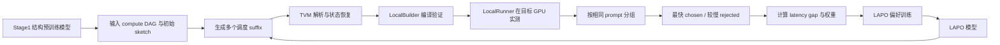

# LAPO：基于真实硬件延迟的编译调度偏好优化

>
> 对应代码目录：`LLM/train/`、`LLM/attention/`。
> 本文中的 LAPO 指本项目实现的 **Latency-Aware Preference Optimization**；其核心训练形式是 **Latency-Weighted DPO**。

---

* [ ] 1. 一句话介绍

**LAPO 的目标，是把 GPU 上实际测得的运行延迟转化为大语言模型能够学习的偏好信号，使模型不仅会生成“合法的 TVM 调度”，还会更倾向于生成“真实运行更快的 TVM 调度”。**

可以把整个方法概括成一句话：

> 对同一个算子和同一个初始调度草图，找出快、慢两个调度后缀，用真实延迟确定偏好方向，再用延迟差距给 DPO 损失加权。

LAPO 不是一个新的 Attention 算法，也不是直接替代 FlashAttention 的算子实现。它是一种**训练调度生成模型的方法**：模型生成 TVM schedule，TVM 负责解析、编译和执行，真实 GPU latency 再反过来监督模型。

---

## 2. 为什么需要 LAPO

### 2.1 编译调度生成的两个目标

用语言模型生成 TVM 调度时，至少有两个不同层次的目标：

1. **结构合法性**：生成的 token 能否还原为 TVM schedule，能否通过解析、编译和 CUDA 合法性检查。
2. **运行性能**：在合法的前提下，生成的 schedule 在目标 GPU 上是否足够快。

这两个目标并不等价。一个 schedule 可以语法正确、能够编译，但其线程绑定、分块、缓存层级或访存方式并不好，最终运行延迟仍然可能很高。

### 2.2 Stage1 预训练的能力边界

本项目中的 Stage1 模型通过监督学习学习已有 TVM measure record 的结构，主要解决：

- TVM 调度序列的表示方式；
- 合法 step 的组合规律；
- 给定 compute DAG 和初始 sketch 后，如何补全后续 schedule；
- 如何提高 parse valid rate 和 build valid rate。

但是，如果训练数据中的 latency 是占位值，或者训练目标只是 next-token prediction，那么模型看到的是“这个后缀在数据中出现过”，而不是“这个后缀比另一个后缀快多少”。因此，Stage1 更接近于：

> 学会生成像 TVM schedule 的序列。

而 LAPO 希望进一步做到：

> 学会在多个合法 schedule 之间偏向真实延迟更低的那个。

### 2.3 为什么不能只用最优样本做 SFT

一种直接方案是只保留最快 schedule，然后继续做监督微调。这个方案有三个不足：

- 它只告诉模型“应该模仿谁”，没有显式告诉模型“应该远离谁”；
- 0.040 ms 对 0.042 ms 和 0.040 ms 对 0.120 ms 在 SFT 中没有区别；
- 继续做交叉熵训练可能让模型偏离原有分布，损害结构合法性或生成多样性。

LAPO 使用成对偏好和冻结参考模型，在保留原模型能力的同时，引入更明确的性能方向。

---

## 3. LAPO 在整个系统中的位置

这是一条闭环：

1. 模型生成候选 schedule；
2. 编译器判断候选是否可执行；
3. GPU 给出真实 latency；
4. latency 被转化为偏好训练数据；
5. 模型更新后重新生成；
6. 再次通过编译和测量验证。

这一闭环的关键价值是：**监督信号来自真实目标硬件，而不是文本相似度或人工打分。**

---

## 4. 模型到底在生成什么

### 4.1 输入与输出

对一个 TVM workload，模型输入可以抽象为：

\[
x=(\text{compute DAG},\ \text{schedule prefix})
\]

模型需要生成的内容是 `PPT` 标记之后的调度决策后缀：

\[
y=(s_{t+1},s_{t+2},\ldots,s_T)
\]

这里的后缀由 TVM 调度 step 序列构成，例如 split、reorder、cache read、cache write、compute at、线程绑定等决策的序列化表示。

### 4.2 `PPT` 的作用

在本项目的数据表示中，`PPT` 是一个重要的决策边界标记：

- `PPT` 之前：compute DAG 和已经确定的初始 sketch/prefix；
- `PPT` 之后：希望模型学习和生成的决策 suffix。

训练和比较时只对 `PPT` 后的后缀计算序列概率，prompt 部分在 label 中被置为 `-100`。因此模型优化的重点是“如何完成后续调度”，而不是重复记忆输入。

### 4.3 为什么偏好对必须具有相同 prompt

如果两个候选来自不同 workload、不同形状或不同初始 sketch，那么延迟差异既可能来自后缀，也可能来自计算规模和前缀结构，偏好标签会被混杂因素污染。

因此，`build_preference_pairs.py` 按“包含首个 `PPT` 的相同 prefix”分组。只有在相同 prompt 下比较两个 suffix，才能把性能差异主要归因于后缀调度决策。

---

## 5. 第一步：由真实测量构造偏好对

### 5.1 真实延迟是硬前提

每个候选 schedule 都需要经历：

1. 还原为 TVM `MeasureInput`；
2. 通过 `LocalBuilder` 构建；
3. 在指定 GPU 上由 `LocalRunner` 执行；
4. 记录多次测量中的有效 latency。

无效、为零、非有限或异常大的 latency 会被过滤。没有真实测量，就无法可靠判断 chosen 和 rejected。

### 5.2 chosen 与 rejected 的选择

对同一个 prompt \(x\)，设候选后缀集合为 \(\mathcal{Y}(x)\)，候选 \(y\) 恢复为可执行程序后的真实延迟为 \(\ell(y)\)。

选择同组中延迟最低的候选作为：

\[
y^+=\arg\min_{y\in\mathcal{Y}(x)}\ell(y)
\]

再从明显较慢的候选中选择 rejected：

\[
y^-\in\left\{y\mid
\frac{\ell(y)}{\ell(y^+)}\ge \gamma
\right\}
\]

其中 \(\gamma\) 是最小延迟差距阈值，对应 `min_latency_gap_ratio`。例如设置为 1.5，表示 rejected 至少比 chosen 慢 50%。

### 5.3 为什么设置最小差距

GPU 微秒级 benchmark 会受到时钟状态、温度、并发进程和同步方式影响。如果把 1% 左右的延迟差异直接当作强偏好，模型可能学习测量噪声。

设置 \(\gamma\) 可以过滤差距过小的样本，提高偏好标签的置信度。代价是偏好对数量减少，因此它体现的是“数据规模”和“标签可靠性”之间的折中。

### 5.4 偏好数据格式

最终每条训练数据包含：

| 字段                 | 含义                                     |
| -------------------- | ---------------------------------------- |
| `prompt`           | compute DAG 和直到`PPT` 为止的调度前缀 |
| `chosen`           | 同组中延迟最低的 suffix                  |
| `rejected`         | 同组中满足最小差距条件的较慢 suffix      |
| `latency_chosen`   | chosen 的真实延迟                        |
| `latency_rejected` | rejected 的真实延迟                      |
| `latency_gap`      | `latency_rejected / latency_chosen`    |
| `latency_weight`   | 由延迟差距计算的 LAPO 权重               |

---

## 6. 第二步：从 DPO 推导 LAPO

### 6.1 序列概率

对 prompt \(x\) 和调度后缀 \(y=(y_1,\ldots,y_T)\)，模型给出的后缀对数概率为：

\[
\log\pi_\theta(y\mid x)
=\sum_{t=1}^{T}\log\pi_\theta(y_t\mid x,y_{<t})
\]

代码中对后缀 token 的 log-prob 求和，prompt 和 padding token 不参与计算。

### 6.2 标准 DPO 的核心量

对一个偏好对 \((x,y^+,y^-)\)，策略模型对 chosen 相对 rejected 的偏好为：

\[
\Delta_\theta
=\log\pi_\theta(y^+\mid x)-\log\pi_\theta(y^-\mid x)
\]

冻结参考模型的对应偏好为：

\[
\Delta_{\mathrm{ref}}
=\log\pi_{\mathrm{ref}}(y^+\mid x)
-\log\pi_{\mathrm{ref}}(y^-\mid x)
\]

两者的差定义为：

\[
h_\theta=\Delta_\theta-\Delta_{\mathrm{ref}}
\]

标准 sigmoid DPO 损失为：

\[
\mathcal{L}_{\mathrm{DPO}}
=-\mathbb{E}\left[\log\sigma(\beta h_\theta)\right]
\]

其中：

- \(\sigma\) 是 sigmoid；
- \(\beta\) 控制偏好优化强度；
- 策略模型 \(\pi_\theta\) 被更新；
- 参考模型 \(\pi_{\mathrm{ref}}\) 冻结不更新。

这项损失希望策略模型相对于参考模型，进一步提高 chosen 的概率并降低 rejected 的相对概率。

### 6.3 参考模型的意义

如果只要求模型无限提高 chosen 的概率，模型可能过度拟合较小的偏好数据集，并破坏原有的结构生成能力。

参考模型相当于一个锚点。DPO 优化的不是绝对概率，而是：

> 当前策略相对于原始 Stage1 模型，是否更偏向真实更快的 schedule。

本次 Attention 实验中的 LAPO checkpoint 和参考 checkpoint 都以同一个 Stage1 模型为起点：

`Qwen3-0.6B-4090-struct-stage1-v2-ext-b2`

因此 Pretrain 与 LAPO 的比较是“偏好训练前”和“偏好训练后”的匹配消融。

---

## 7. LAPO 的核心：让延迟差距决定训练权重

### 7.1 普通 DPO 丢失了多少信息

普通 DPO 只使用二元标签：

\[
y^+\succ y^-
\]

它会把下面两组样本近似同等对待：

- 0.040 ms 对 0.044 ms；
- 0.040 ms 对 0.120 ms。

但第二组候选之间有更明显的实际性能差距，偏好标签更可靠，对性能方向也更重要。

### 7.2 延迟比与权重

首先定义延迟比：

\[
r_\ell=\frac{\ell^-}{\ell^+}>1
\]

当前代码支持以下权重策略：

| 策略               | 权重公式                            | 特点                             |
| ------------------ | ----------------------------------- | -------------------------------- |
| `uniform`        | \(w=1\)                             | 等价于普通 DPO                   |
| `log_gap`        | \(w=\max(1,1+\log r_\ell)\)         | 默认推荐，强调大差距但增长较平缓 |
| `linear_gap`     | \(w=\max(1,r_\ell)\)                | 对大差距样本更激进               |
| `clipped_linear` | \(w=\max(1,\min(w_{\max},r_\ell))\) | 线性加权并限制极端值             |

训练阶段还可以再次通过 `lapo_weight_clip` 对权重做上限裁剪。

### 7.3 Batch 内归一化

为避免不同 batch 的平均权重差异直接改变有效学习率，代码可将权重归一化到 batch 均值为 1：

\[
\widetilde{w}_i=
\frac{w_i}{\frac{1}{B}\sum_{j=1}^{B}w_j+\epsilon}
\]

最终 LAPO 损失为：

\[
\mathcal{L}_{\mathrm{LAPO}}
=-\frac{1}{B}\sum_{i=1}^{B}
\widetilde{w}_i\log\sigma(\beta h_{\theta,i})
\]

因此，LAPO 可以理解为：

> 保留 DPO 的相对偏好学习与参考模型约束，同时把连续 latency 差距注入每个偏好对的梯度大小。

### 7.4 梯度直觉

忽略 label smoothing 时，单个样本的梯度可写成：

\[
\nabla_\theta\mathcal{L}_i
=-\widetilde{w}_i\beta
\left(1-\sigma(\beta h_{\theta,i})\right)
\nabla_\theta h_{\theta,i}
\]

可以得到两个直观结论：

1. **延迟差距越大，权重越大，模型对该偏好对更新得越强。**
2. **当模型已经正确区分 chosen 和 rejected 时，sigmoid 项会自动减小，避免持续过度优化容易样本。**

### 7.5 一个数值例子

假设：

- chosen 延迟为 0.040 ms；
- rejected 延迟为 0.100 ms；
- 使用 `log_gap`。

则：

\[
r_\ell=0.100/0.040=2.5
\]

\[
w=1+\log(2.5)\approx1.916
\]

这组偏好对的原始权重约为 1.916。若另一个偏好对的延迟比只有 1.5，则其权重约为 1.405。经过 batch 归一化后，二者总体平均仍为 1，但前者获得更大的相对梯度。

---

## 8. SFT、DPO 与 LAPO 的区别

| 方法 | 训练数据                | 优化目标                         | 是否利用慢样本 | 是否利用延迟幅度   | 是否有参考模型约束 |
| ---- | ----------------------- | -------------------------------- | -------------- | ------------------ | ------------------ |
| SFT  | prompt + 最优 suffix    | 提高 chosen token 概率           | 否             | 否                 | 否                 |
| DPO  | chosen / rejected 对    | 提高 chosen 相对 rejected 的偏好 | 是             | 否，只使用快慢方向 | 是                 |
| LAPO | 带真实 latency 的偏好对 | 按延迟差距加权 DPO               | 是             | 是                 | 是                 |

汇报时可以这样总结：

- **SFT 学“标准答案是什么”；**
- **DPO 学“两个答案中更喜欢哪个”；**
- **LAPO 进一步学习“应该多强烈地偏好更快的答案”。**

---

## 9. 当前代码中的实现对应关系

### 9.1 `train/build_preference_pairs.py`

作用：从 TVM 实测 record 构造偏好对。

核心行为：

- 读取并恢复 workload 与 compute DAG；
- 定位首个 `PPT`；
- 将相同 prefix 的样本放入同一组；
- 过滤没有有效 latency、suffix 太短或长度超限的样本；
- 选择组内最低 latency 作为 chosen；
- 按 `min_latency_gap_ratio` 过滤 rejected；
- 计算 `latency_gap` 和 `latency_weight`；
- 以 workload 文件为单位划分训练集和验证集，避免同一 workload 泄漏。

### 9.2 `train/train_qwen3_dpo.py`

作用：实现 `sft`、`dpo`、`lapo` 三种训练模式。

LAPO 模式的主要计算流程：

1. 分别计算 policy 对 chosen 和 rejected 后缀的序列 log-prob；
2. 用冻结 ref model 计算相同的两项 log-prob；
3. 计算逐样本 DPO loss；
4. 读取 `latency_weight`；
5. 执行权重裁剪和 batch 归一化；
6. 对逐样本 DPO loss 加权求均值。

训练日志中的关键指标包括：

- `reward/chosen_mean`：模型对 chosen 的隐式奖励；
- `reward/rejected_mean`：模型对 rejected 的隐式奖励；
- `reward/accuracy`：chosen reward 高于 rejected 的比例；
- `reward/margin_mean`：两者平均奖励间隔。

### 9.3 `train/run_train_qwen3_dpo.py`

作用：封装分布式训练入口，通过 `TRAINING_MODE=lapo` 或 `LAPO=true` 启动 LAPO。

本次实验所用 checkpoint 的训练清单记录为：

| 项目             | 值                                          |
| ---------------- | ------------------------------------------- |
| training mode    | `lapo`                                    |
| policy 起点      | `Qwen3-0.6B-4090-struct-stage1-v2-ext-b2` |
| reference model  | 同一个 Stage1 checkpoint                    |
| beta             | 0.1                                         |
| loss type        | sigmoid                                     |
| label smoothing  | 0.0                                         |
| weight clip      | 5.0                                         |
| batch 权重归一化 | 开启                                        |

### 9.4 当前实现与后续设想的边界

当前可运行实现已经包含：

- 真实 latency 测量；
- 同 prompt 偏好对构造；
- DPO/LAPO 自定义训练；
- 生成、编译、测量和端到端评估。

使用 cost model 给未测样本生成伪 latency、再扩充偏好数据，属于可选扩展方向，不是当前 Attention v1 结果的必要组成部分。

---

## 10. LAPO 在 Attention 实验中的落地

### 10.1 实验对象

实验目录：`/home/qsy/workspace/gen_data/attention_b1_s128_fp16`

固定形状来自 Qwen3-0.6B 的 causal GQA attention：

| 项目            | 配置                    |
| --------------- | ----------------------- |
| GPU             | NVIDIA GeForce RTX 4090 |
| batch           | 1                       |
| sequence length | 128                     |
| query heads     | 16                      |
| KV heads        | 8                       |
| head dimension  | 128                     |
| dtype           | FP16                    |
| causal          | true                    |

TVM 侧抽取出 3 个 AutoScheduler task：

1. softmax；
2. batch matmul；
3. batch matmul + scale/add。

需要强调：TVM 侧是完整 Attention Relay 图的多 kernel 实现，不是 FlashAttention 的 fused online-softmax 算法；最终延迟来自完整图 benchmark，不是手工把三个 task 的最优 latency 相加。

### 10.2 公平比较设置

Pretrain 与 LAPO 使用：

- 完全相同的 3 个 workload；
- 完全相同的初始 sketches；
- 相同的随机种子和采样设置；
- 每个 workload 相同的候选保留预算 `keep_cnt=64`；
- 相同的 TVM 构建、测量和完整图 benchmark 流程。

Pretrain 必须使用 LAPO 训练清单中的真正父 checkpoint。否则比较会同时混入“Stage1 checkpoint 不同”和“是否经过 LAPO”两个变量，不能作为干净消融。

### 10.3 候选生成阶段结果

| 来源             | generation prompts | parsed states | build 有效/尝试 | build 有效率 | 最终保留 |  总耗时 |
| ---------------- | -----------------: | ------------: | --------------: | -----------: | -------: | ------: |
| LAPO             |                570 |           253 |       194 / 250 |        77.6% |      192 | 605.6 s |
| matched Pretrain |                621 |           259 |       193 / 255 |        75.7% |      192 | 679.6 s |

从候选生成角度，LAPO 使用更少的 prompts 和更少的总时间完成相同的 3×64 候选预算，build 有效率也略高。这说明它生成可构建候选的效率有所改善，但**build valid rate 不等于最终运行性能**。

### 10.4 最终 steady 端到端结果

| 后端             | median latency | p95 latency | 相对 FlashAttention |
| ---------------- | -------------: | ----------: | ------------------: |
| LAPO             |    0.027431 ms | 0.027577 ms |             3.648× |
| matched Pretrain |    0.020417 ms | 0.027616 ms |             4.902× |
| FlashAttention   |    0.100079 ms | 0.100499 ms |             1.000× |
| Torch eager      |    0.129394 ms | 0.172540 ms |             0.773× |

所有后端均通过与 Torch eager 的数值正确性检查。

由此得到两条需要同时汇报的结论：

1. **LAPO 生成的 TVM Attention 在这一固定小形状上比 FlashAttention 快 3.648 倍。**
2. **LAPO 没有稳定超过匹配的 Pretrain；steady 结果中，LAPO/Pretrain speedup 为 0.744，即 LAPO 更慢。**

### 10.5 为什么 LAPO 赢了两个 task，却没有赢完整图

Task-level 最佳记录如下：

| Task                     |   LAPO best | Pretrain best | 结果                |
| ------------------------ | ----------: | ------------: | ------------------- |
| softmax                  | 0.002908 ms |   0.002936 ms | LAPO 约快 1.0%      |
| batch matmul             | 0.007005 ms |   0.004903 ms | Pretrain 约快 42.9% |
| batch matmul + scale/add | 0.007025 ms |   0.007635 ms | LAPO 约快 8.0%      |

LAPO 在 3 个 task 中赢了 2 个，但在计算量较大的 batch matmul 上落后更多，抵消了另外两项的小幅收益。这说明：

> 评价调度模型不能只统计“赢了多少个 task”，还要考虑 task 的性能贡献，并以完整图或完整网络 latency 为最终依据。

### 10.6 如何正确理解与 FlashAttention 的对比

这一结果不意味着 TVM 多 kernel Attention 在所有情况下都优于 FlashAttention。当前形状是 `B=1, S=128`，工作负载很小，固定形状特化和 kernel 启动开销会显著影响结果；FlashAttention 的主要优势通常在更长序列和更强的显存带宽压力下体现。

因此，严谨表述应为：

> 在 RTX 4090、FP16、B=1、S=128 的固定 Qwen3 GQA 形状上，当前 LAPO 生成的 TVM 完整 Attention 图测得比 FlashAttention 2.7.1 更低的延迟；该结论尚不能外推到其他序列长度或整个 Qwen3 模型。

---

## 11. LAPO 的优势

### 11.1 直接利用目标硬件反馈

训练目标来自真实 GPU latency，能够学习编译器静态规则难以完整表达的硬件行为，例如访存、并行度、寄存器压力和 kernel 配置之间的综合影响。

### 11.2 不需要人工编写 reward

延迟天然满足“越小越好”，不需要人工评价 schedule，也不需要语言模型充当裁判。

### 11.3 比二元 DPO 保留更多信息

LAPO 不仅知道谁快，还保留“快多少”的连续信息，并将其用于控制梯度权重。

### 11.4 保留参考模型约束

模型不是完全脱离 Stage1 重新训练，而是在冻结参考模型附近学习性能偏好，降低结构能力灾难性退化的风险。

### 11.5 可形成持续迭代闭环

新模型可以继续生成候选、补充真实测量并产生新的偏好对，形成数据和模型共同迭代的 autotuning 流程。

---

## 12. 局限性与风险

### 12.1 真实测量成本高

偏好数据必须经过编译和 GPU 运行。大规模 workload、候选和重复测量会消耗大量 GPU 时间。

### 12.2 微秒级延迟存在噪声

GPU P-state、温度、功耗限制、其他进程和同步方法都可能改变结果。当前 Attention 实验中 LAPO 与 Pretrain 的相对排序在不同复测轮次发生过反转，因此小幅领先不能直接视为稳定收益。

### 12.3 强硬件相关性

在 RTX 4090 上学习到的偏好不一定适用于 A100、H100 或其他架构。LAPO 更准确的定位是 target-aware，而不是硬件无关。

### 12.4 偏好对只表达局部相对关系

相同 prompt 分组保证了比较公平，但也限制了候选覆盖范围。如果每组候选过少，chosen 只是“当前采样集合中的最好”，不一定接近全局最优。

### 12.5 权重可能放大异常值

错误测量或极端 latency 比可能产生过大权重。因此需要：

- 重复测量；
- 异常值过滤；
- 最小差距阈值；
- `log_gap`；
- weight clip；
- batch normalization。

### 12.6 后缀序列长度可能影响 log-prob

当前实现对 suffix token log-prob 求和。不同长度序列的总 log-prob 尺度不同，虽然 chosen/rejected 通常来自相近的调度空间，但仍应在消融中关注长度分布，必要时比较 sum 与 length-normalized log-prob。

### 12.7 算子级结果不等于整模型结果

Attention 固定形状实验用于验证方法边界。要证明对 Qwen3 整体推理有收益，还需要覆盖完整网络的所有主要 workload，并测量 Relay 或真实推理端到端 latency。

---

## 13. 建议的评价指标

汇报 LAPO 时，不建议只展示单个 latency。至少应分成四组指标：

### 13.1 生成质量

- parse valid rate；
- build valid rate；
- 每个 workload 获得 K 个有效候选所需 prompts；
- 生成与构建总耗时。

### 13.2 偏好学习

- reward accuracy；
- chosen/rejected reward margin；
- DPO/LAPO validation loss；
- 结构合法率是否相对 Stage1 下降。

### 13.3 调度性能

- best-of-K latency；
- median candidate latency；
- 相对 Stage1、DPO、Ansor 的 speedup；
- hold-out workload 上的 geometric mean speedup。

### 13.4 端到端性能

- 完整算子图 latency；
- 完整网络 Relay latency；
- 正确性误差；
- 峰值显存；
- 多次独立进程复测的 median、p95 和置信区间。

---

## 14. 推荐的消融实验

为了证明收益确实来自 LAPO，建议至少比较：

1. **Stage1 Pretrain**：偏好训练前基线；
2. **Chosen-only SFT**：只用最快样本继续监督训练；
3. **Vanilla DPO**：`uniform` 权重；
4. **LAPO-log**：`log_gap` 权重；
5. **LAPO-linear**：线性或裁剪线性权重；
6. 不同 \(\beta\)：例如 0.02、0.05、0.1；
7. 不同最小差距 \(\gamma\)：例如 1.2、1.5、2.0；
8. 是否 batch normalization；
9. 不同偏好对数量；
10. 不同 GPU 和不同序列长度。

公平消融必须保持：

- 相同父 checkpoint；
- 相同 tokenizer；
- 相同训练数据划分；
- 相同初始 sketches；
- 相同生成预算和随机种子；
- 相同测量协议。

---

## 15. 汇报时可直接使用的讲述稿

### 15.1 开场：问题是什么

> 我们前一阶段已经让 Qwen3 学会生成结构合法的 TVM 调度，但是合法不代表高性能。传统交叉熵训练只能学习数据中出现过什么，无法直接知道两个合法 schedule 在 RTX 4090 上谁更快。因此，我们引入 LAPO，把真实 GPU latency 变成模型可学习的偏好信号。

### 15.2 方法：LAPO 怎么做

> 首先，对同一个 compute DAG 和同一个初始 sketch，模型生成多个调度后缀。我们将这些后缀恢复成 TVM schedule，实际编译并在 GPU 上测量。组内最快的后缀作为 chosen，明显更慢的后缀作为 rejected。然后使用 DPO，让策略模型相对于冻结的 Stage1 参考模型，更偏向 chosen。

### 15.3 创新：与普通 DPO 有什么不同

> 普通 DPO 只知道 A 优于 B，却不知道快多少。LAPO 进一步计算 rejected latency 与 chosen latency 的比值，并用这个差距给 DPO loss 加权。差距越大、标签越可靠、性能意义越强，训练梯度就越大。为了防止异常值改变整体学习率，我们采用对数权重、上限裁剪和 batch 内均值归一化。

### 15.4 实验：如何验证

> 在 Attention 实验中，我们固定 Qwen3-0.6B 的 B=1、S=128、FP16 causal GQA 形状，让偏好训练前的 Stage1 模型和 LAPO 模型使用完全相同的 sketches、采样参数和每个 workload 64 条候选预算。所有候选都经过 TVM 编译、真实 GPU 测量和完整 Relay Attention 图 benchmark。

### 15.5 结果：应该如何表述

> LAPO 生成的完整 TVM Attention 图延迟为 0.027431 ms，FlashAttention 为 0.100079 ms，在这个固定小形状上测得 3.648 倍加速。但是 matched Pretrain 的 steady 延迟是 0.020417 ms，仍快于 LAPO。所以当前结果证明了 LAPO 模型能够生成具有竞争力的 schedule，也证明了完整闭环可运行，但尚不能证明 LAPO 稳定优于其父模型。下一步重点是扩大真实偏好数据、稳定测量协议，并解决 batch matmul task 上的退化。

### 15.6 收尾：方法价值

> LAPO 的核心价值不只是一轮加速数字，而是建立了“生成—编译—实测—偏好训练—再生成”的闭环，让语言模型从学习调度语法，进一步走向学习目标硬件上的性能偏好。

---

## 16. 常见提问与回答

### Q1：LAPO 是强化学习吗？

广义上它属于基于偏好的策略优化，但当前实现不是 PPO 式在线强化学习。它使用离线构造的 chosen/rejected 数据，通过 DPO 形式直接优化语言模型，不需要单独训练 value model，也不需要在线 rollout 计算策略梯度。

### Q2：LAPO 和普通 DPO 的唯一区别是什么？

核心区别是逐样本权重。普通 DPO 对每个偏好对默认同权；LAPO 根据真实 latency gap 为每个偏好对赋予不同权重，并通过裁剪和归一化保持训练稳定。

### Q3：为什么不用绝对 latency 做回归？

绝对 latency 跨 workload 和形状的尺度差异很大，而且回归模型学会打分并不等于生成模型学会产生更优 schedule。LAPO 在相同 prompt 内做相对比较，减少 workload 尺度影响，并把性能偏好直接注入生成模型。

### Q4：为什么需要冻结 reference model？

参考模型用于约束策略不要为了少量偏好数据过度偏移。优化目标是“比原模型更偏向快 schedule”，而不是无约束地最大化某些样本的概率。

### Q5：为什么选择延迟比，而不是延迟差值？

延迟比具有尺度归一性。例如从 1 ms 降到 0.5 ms 和从 0.1 ms 降到 0.05 ms 都表示 2 倍改善；绝对差值则会偏向本身耗时较大的 workload。

### Q6：LAPO 为什么没有稳定超过 Pretrain？

可能原因包括真实偏好数据覆盖不足、训练分布与 Attention workload 的分布差异、权重和 \(\beta\) 尚未充分调优，以及微秒级 benchmark 噪声。当前 task-level 结果还显示 LAPO 在核心 batch matmul 上明显落后，这一项抵消了其他 task 的收益。

### Q7：LAPO 比 FlashAttention 快，是否说明算法更先进？

不能这样推断。当前对比是一个 `B=1, S=128` 的固定小形状，TVM 进行了固定形状特化；FlashAttention 是面向更广泛形状、尤其是较长序列和显存压力的通用融合算法。该结果只说明在当前硬件、形状和测量条件下，LAPO 生成的 TVM 实现延迟更低。

### Q8：如何证明模型真正学到了性能偏好？

需要同时满足：hold-out workload 上 reward accuracy 提升、build valid rate 不下降、相同 best-of-K 预算下 latency 下降，并且在多次独立复测中稳定优于 matched Pretrain 和 vanilla DPO。

---

## 17. 最终总结

LAPO 解决的是调度生成模型中“结构正确但不一定高性能”的问题。它的技术路线可以归纳为四点：

1. **可执行表示**：模型输出能够恢复为 TVM schedule；
2. **真实反馈**：使用目标 GPU 上的实际 latency，而不是文本分数；
3. **相对偏好**：在相同 prompt 下构造 chosen/rejected，减少混杂因素；
4. **幅度感知**：用 latency gap 加权 DPO，使性能差距更大的样本产生更强训练信号。

当前 Attention 实验已经证明这条“生成—编译—测量—偏好优化”的系统链路能够完整运行，并在固定 `B=1, S=128` 形状上生成了明显快于 FlashAttention 的 TVM 实现。但严谨结论同样需要指出：LAPO 暂未在 steady benchmark 中稳定超过 matched Pretrain，后续仍需扩大偏好数据覆盖、加强测量稳定性，并针对关键 batch matmul workload 优化训练与候选生成。

---

## 18. 相关文件

- `LLM/train/build_preference_pairs.py`：偏好对构造与 latency weight；
- `LLM/train/train_qwen3_dpo.py`：SFT、DPO、LAPO 损失实现；
- `LLM/train/run_train_qwen3_dpo.py`：训练启动入口；
- `LLM/docs/guides/qwen3_train_guide.md`：完整训练说明；
- `LLM/attention/README.md`：Attention 公平对比流程；
- `LLM/attention/run_generation.py`：Pretrain/LAPO 等预算候选生成；
- `LLM/attention/benchmark_tvm_attention.py`：完整 TVM Attention benchmark；
- `LLM/attention/benchmark_flash_attention.py`：FlashAttention benchmark；
- `/home/qsy/workspace/gen_data/attention_b1_s128_fp16/experiment_summary.md`：本次实验结果总结。
